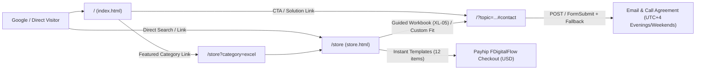

# Website Redesign, Consulting Funnel & Google Indexing Overhaul (`federico-d.web.app`)

*   **Author:** federicodumagpijr-tech
*   **Status:** Approved & Resolved — Ready for Swarm Implementation
*   **Date:** 2026-11-14

--------------------------------------------------------------------------------

## Overview

This specification covers the redesign of `https://federico-d.web.app/` so search visitors—including office managers, HR coordinators, and small-business owners on mobile devices—can read pages at `>= 16px` body text, review consulting and 1-on-1 training capabilities in plain English, submit structured project inquiries, or purchase digital toolkits via Payhip.

The website remains a static HTML5, CSS, and framework-free JavaScript application on Firebase Hosting with no custom backend, operated by Federico Dumagpi Jr. with **evening and weekend remote support (`Dubai UTC+4`)**.

## The Problem

Auditing `mywebsite_f` identifies four technical and content defects across indexing, service positioning, mobile typography, and storefront metadata:

1. **Canonical Indexing Misdirection & Exposed Internal Files:**
   `index.html` and `store.html` declare `<link rel="canonical">` pointing to `https://federicodumagpi.com/` instead of `https://federico-d.web.app/`. `robots.txt` and `sitemap.xml` are absent, `404.html` retains the default Firebase CLI placeholder without `noindex` or navigation, and `firebase.json` deploys `"public": "."` with root-only ignores that expose `README.md`, `Product descriptions/*.txt`, unreferenced root SVGs, and nested Markdown documents. Meanwhile, `.gitignore` ignores `images/` and `bg_images/`, so assets stored there cannot deploy through GitHub Actions.

2. **Narrow Homepage Positioning & Broken Calculator Defaults:**
   Hero and body sections focus heavily on enterprise `4,800`-employee biometric attendance (`08:00 - 18:00 Gulf Standard Time [GST]`) rather than general **Excel data modeling, basic-to-advanced training, Power Query ETL, Power BI dashboards, Power Automate workflows, and HRIS/Compensation & Benefits** consulting. The simulator starts at `min="500"`, auto-runs at `500ms`, displays `0.00 min`, and primary calls to action direct visitors to `$15` downloads rather than scoping custom work first.

3. **Sub-12px Mobile Typography, Square Box Clutter & Broken Frontend Code:**
   More than 15 label and table selectors set text between `9px` and `11px` (`0.5625rem–0.6875rem`), while sharp corners, `2px` frames, hard offset shadows, and `word-break: break-word` display rules crowd narrow viewports. HTML files load Tailwind Play CDN despite missing custom utility tokens (`bg-paper`, `text-slate-3`, `shadow-hard`), `styles.css` contains malformed orphan properties and duplicate scroll-overflow rules that disable sticky headers and `#scroll-progress`, header/footer nav counts disagree, and FormSubmit navigates off-site before showing confirmation.

4. **Uncategorized Storefront, Deliverable Mismatches & Platform Drift:**
   `store.html` combines corporate payroll workbooks, a Windows `.exe` extractor, B2B AI playbooks, an educator planner, and a wellness guide into one flat catalog with a 13-link jump wall. Header and store copy promote Gumroad (`dumagpi8`) despite Payhip-only checkout links, 9 descriptions disagree with `Product descriptions/*.txt` (including falsely claiming `.XLSX` for `#health-coach`), `$15` vs. `AED 250` items lack distinct positioning (`#13` wrongly bears an `"Instant Download"` pill), and Power Query tools fail to specify Windows Excel desktop requirements vs. cross-platform `.html`/`.md` components.

## Goals

*   **Search Engine Visibility:** Establish `https://federico-d.web.app/` as the sole canonical host (disabling `federicodumagpijr-tech.github.io` in GitHub Pages settings), adding `robots.txt`, `sitemap.xml`, `cleanUrls`, Open Graph metadata, light-mode favicons, a site-styled `noindex, nofollow` `404.html`, and valid JSON-LD (targeting Lighthouse Performance `>= 90` and SEO `100`).
*   **Consulting-First Inquiry Funnel:** Position `index.html` around **Excel (foundations to clean data structures), Power Query/ETL, Data Analysis, Power BI, Power Automate, and HRIS/Attendance/Compensation** consulting and tutoring, using progressive + AJAX FormSubmit intake (`Evening & Weekend Support — Dubai UTC+4`) before email/call scope and fee agreement.
*   **Mobile-Readable Light Interface:** Preserve the 4-color light palette (`#111827`, `#ED1C24`, `#059669`, `#D97706` with WCAG AA `-ink` text variants and `>= 3:1` control borders), adopting rounded cards, split layouts, soft depth, `>= 12px` labels, `>= 16px` body/input text, `prefers-reduced-motion`-safe reveals, and zero page-level horizontal overflow from `320px` to `1440px`.
*   **Lightweight Domain Visuals & Zero-Bloat Speed:** Eliminate Tailwind Play CDN, Font Awesome CDN, and multi-megabyte stock images; render crisp HTML/CSS/SVG previews of anonymized Excel, Power Query, Power BI, and Power Automate deliverables paired with one compressed tracked WebP desk visual (`<= 80 KB`).
*   **Categorized Payhip Storefront (`13` SKUs):** Organize all `13` products into `4` audience groups with deliverables audited against `Product descriptions/*.txt`, explicit runtime tiers (Cross-Platform HTML/AI vs. Win/Mac `.xlsx` vs. Windows Power Query `.m` / `.exe`), consistent `USD` pricing, Payhip-only checkout links (`FDigitalFlow`, zero Gumroad links), and distinct custom-inquiry routing for the `$68` Guided Setup workbook (`XL-05`).
*   **Reduced Duplication & Safe Parity:** Avoid repeating full SKU deliverables/prices on `index.html`, compute store category counts dynamically in JavaScript, isolate public deployment with recursive ignore rules, and verify cross-page header/canonical parity via a zero-dependency Python verification pass.

## Non-Goals

*   No dark mode theme or theme toggle.
*   No backend server, SQL/NoSQL database, user accounts, or SPA frameworks (React, Vue, Next.js).
*   No Gumroad links anywhere on the website.
*   No AI-generated, watermarked, or multi-megabyte (`> 150 KB`) stock photographs.
*   No multi-article content blog prior to baseline Google Search Console indexing and impression tracking.

## Open Questions

All architectural questions are finalized:

*   **Deployment Boundary & Sync:** Retain root-relative static files under Firebase Hosting `"public": "."` protected by strict **recursive** ignore globs covering all non-public folders, nested `.md`/`.py`/`.txt` files, and unreferenced root SVGs (`antigravitylogo.svg`, `firebaselogo.svg`), paired with an automated pre-deploy stdlib parity verifier.
*   **Canonical & Clean URL Strategy:** Serve extensionless canonical URLs (`/` and `/store`) across internal navigation, canonical links, JSON-LD, and `sitemap.xml`, validated locally through Firebase Hosting Emulator rather than plain `file://` or `python -m http.server`.
*   **Visual Proof Strategy:** Combine anonymized interactive HTML/CSS/SVG workflow/table previews (Excel/Power Query, Power BI, Power Automate) with one committed compressed real-world WebP workspace image (`assets/consulting-desk.webp <= 80 KB`) and tracked binary favicons/Open Graph assets (`favicon.png`, `assets/og-card.png`).

## Critical User Journeys (CUJs)

### CUJ 1: Mobile Excel/Automation Prospect Arriving From Google Search

*   **Given:** A manager or HR coordinator searches Google on a `375px` phone for Excel, Power Query, Power BI, or attendance help and lands on `https://federico-d.web.app/`.
*   **When:** They read the homepage overview, test the interactive workflow time-savings estimator (`10` to `5,000` records/employees), review the Excel/Power BI/Power Automate capability previews and `18+` year HRIS credentials, and submit the consultation inquiry form.
*   **Then:** Copy renders cleanly at `>= 12px` labels and `>= 16px` body text without horizontal scroll; **Evening & Weekend (`UTC+4`)** consulting workflow is unambiguous; submitting the inquiry executes asynchronously without page reload, validates required fields and JSON confirmation, and offers an immediate pre-populated `mailto:` fallback if network/endpoint errors occur.

### CUJ 2: Visitor Exploring Ready-Made Spreadsheets vs. AI Prompt Guides

*   **Given:** A visitor arrives directly at `/store` from Google Search or navigates via homepage links (`/store` or `/store?category=excel`).
*   **When:** They filter audience groups via accessible pointer or keyboard controls, review plain-English runtime compatibility notes (browser `.html`/`.md` vs. Win/Mac Excel `.xlsx` vs. Windows Power Query `.m`), and expand package deliverables.
*   **Then:** Deliverables accurately match `Product descriptions/*.txt` and verified storefront manifests; instant-download packages open USD checkouts on **Payhip** (`FDigitalFlow`) with zero Gumroad references, while custom multi-branch workbook requests pre-fill the consulting intake on `/` (`/?topic=custom-payroll&item=XL-05#contact`).

### CUJ 3: Googlebot Crawl & Missing-URL Recovery

*   **Given:** Search crawlers index `https://federico-d.web.app/` and `/store`, or visitors hit stale `.html` links or missing paths.
*   **When:** Requests arrive for `/robots.txt`, `/sitemap.xml`, `/store.html`, internal repo documentation paths, or an invalid route.
*   **Then:** Internal docs and unused root SVGs return HTTP 404; `/store.html` redirects cleanly (`301`) to `/store`; `robots.txt` allows crawling `/`, `/store`, and `/404` so crawlers see `<meta name="robots" content="noindex, nofollow">` on `404.html`, while human visitors get clear recovery links to Home, Store, and Contact Inquiry.

## Technical Plan (Architecture)

The site remains a zero-build static web application deployed from the `main` branch via `.github/workflows/firebase-hosting-merge.yml` to Firebase project `federico-d` (`https://federico-d.web.app/`), with optional pull-request preview deployments via `.github/workflows/firebase-hosting-pull-request.yml`. GitHub Pages (`federicodumagpijr-tech.github.io`) is retired by setting **Source = None** in repository settings without changing the Firebase deployment workflows.

### User Flow Diagram



### Hosting Boundary Diagram

```text
+-------------------------------------------------------------------------+
|                   Firebase Static Hosting (firebase.json)               |
|  "public": ".", "cleanUrls": true, "trailingSlash": false               |
+-------------------------------------------------------------------------+
| SERVED PUBLICLY                       | BLOCKED FROM HOSTING ("ignore") |
| - /            (index.html)           | - Product descriptions/**       |
| - /store       (store.html)           | - docs/**, **/*.md              |
| - /404.html    (noindex, nofollow)    | - **/*.py, !(robots).txt,      |
| - /robots.txt  & /sitemap.xml         |   */**/*.txt, README.md        |
| - /robots.txt  & /sitemap.xml         | - bg_images/**, images/**       |
| - /styles.css  & /script.js           | - antigravitylogo.svg           |
| - /favicon.svg & /favicon.png         | - firebaselogo.svg              |
| - /assets/     (consulting-desk.webp, | - firebase.json, .firebaserc    |
|                 og-card.png)          | - .git/**, .github/**, **/.*    |
+-------------------------------------------------------------------------+
```

### Component Boundaries

1. **Hosting, SEO & Routing Layer:** Enforces canonical `https://federico-d.web.app/` identity, extensionless clean routes, recursive ignore rules blocking non-web assets, security headers, crawl directives (`robots.txt`, `sitemap.xml`), and light-mode social/favicon assets.
2. **Design System & Presentation Layer:** Consolidates typography (`>= 12px` labels, `>= 16px` copy), WCAG AA contrast-checked `-ink` fills and `>= 3:1` control borders, rounded surfaces, soft shadows, reduced-motion defaults, and inline SVG iconography with zero external Tailwind or Font Awesome dependencies.
3. **Homepage Consulting Funnel:** Organizes consulting positioning (`Solutions`, `Power Query Workflow Simulator`, `18+ Years Track Record`, `Process & Integrated FAQ`, and `Inquiry & Evening UTC+4 Schedule`) using existing career credentials (`Al Ansari Financial Services PJSC` & ISO 9001 auditor proof) cleanly framed around evening/weekend remote delivery.
4. **Categorized Digital Store & Client Interactivity Layer:** Groups all `13` offerings into `4` clear categories with runtime compatibility labeling, promotes bundled offline `.html` browser utilities alongside Excel/Power Query and AI Skills, eliminates the legacy 13-item jump wall, routes guided workbooks (`XL-05`) and bespoke inquiries to `/?topic=...#contact`, and parameterizes shared tab/filter/drawer/form-fallback behavior in a single deferred `script.js`.

## Non-Functional Requirements

*   **Performance & Asset Budgets:** Zero external CSS/JS framework CDNs; uncompressed `styles.css` `< 35 KB`; initial rendered image payload on `/` `< 350 KB` (`assets/consulting-desk.webp <= 80 KB`, `assets/og-card.png <= 120 KB`); explicit `width`/`height` dimensions; target DevTools/Lighthouse metrics `>= 90` Performance, `100` SEO, `CLS < 0.1` on mobile and desktop with `fonts.googleapis.com` preconnect and `display=swap`.
*   **Accessibility & Responsive Reliability:** Minimum `12px` labels and `16px` body/form inputs; WCAG AA text contrast `>= 4.5:1` across light surfaces and footer backgrounds plus WCAG 2.1 `>= 3:1` non-text contrast on interactive borders; zero document-level horizontal overflow (`document.documentElement.scrollWidth <= window.innerWidth`) from `320px` to `1440px` while collapsing demo comparison tables cleanly on `< 640px`; keyboard-accessible drawer focus trap, simulation controls, tabs, category filters, `<details>` FAQs, and spec accordions; full `prefers-reduced-motion: reduce` static visibility fallback.
*   **Privacy, Employer Boundaries & Security:** Strictly anonymized synthetic data inside all demo tables and flow previews (zero confidential company logs or real staff records); explicit `Evening & Weekend Support (UTC+4)` hours avoiding daytime overlap with public stock-listed company (**PJSC** — *Public Joint-Stock Company*) employment; non-web files blocked by recursive ignore globs; safe static security headers (`X-Content-Type-Options: nosniff`, `X-Frame-Options: DENY`, `Referrer-Policy: strict-origin-when-cross-origin`).
*   **Verification, Rollout & Rollback:** Pre-deploy verification via stdlib Python check, `firebase emulators:start --only hosting` clean-URL/ignore audit, GitHub PR preview channel validation prior to merging to `main`, live FormSubmit endpoint activation check on `https://federico-d.web.app/`, and paired rollback via `git revert` + Firebase Hosting release rollback.

## Risks & Mitigations

| Risk / Failure Mode | Impact | Concrete Mitigation |
| :--- | :--- | :--- |
| **Fail-Open Root Deployment (`"public": "."`)** | New nested `.md`/`.py`/`.txt` files or unused root SVGs get served publicly if missed in `"ignore"`. | Enforce explicit recursive globs (`**/*.md`, `**/*.py`, `**/*.txt`, `docs/**`, `Product descriptions/**`, `antigravitylogo.svg`, `firebaselogo.svg`) AND run mandatory HTTP 404 negative assertions on internal paths in Tier 2 verification. |
| **FormSubmit Outage, Unactivated Origin, or Captcha Block** | Inquiries silently fail or bounce without reaching email inbox; raw Gmail invites scrapers. | Retain native `method="POST"` action + `_captcha="false"` + `_honey` honeypot + `9s` `AbortController` timeout + explicit `data.success` JSON check; render a pre-populated `mailto:` error fallback link inside `#form-status` preserving typed user inputs; document pre-go-live activation on `federico-d.web.app` (and PR preview channels) and optional swap to FormSubmit's generated email alias once activated. |
| **Canonical Split With Legacy `federicodumagpi.com` & `github.io` 404 Shock** | Search impressions stay diluted or legacy `.github.io` backlinks immediately hit 404s. | Set canonical strictly to `https://federico-d.web.app/`; owner verifies `federicodumagpi.com` status (configure 301 redirect if still owned, otherwise submit Google Search Console URL inspection/removal); switch GitHub Pages to `Source: None` immediately upon live verification of `federico-d.web.app`. |
| **Excel Win/Mac & Google Sheets Compatibility Disputes** | Buyers on macOS Excel or Google Sheets expect Power Query `.m` automation to refresh cleanly. | Assign explicit runtime compatibility labels on `/store` (`Windows Excel Power Query .m` vs `Win/Mac .xlsx` vs `Cross-Platform Browser HTML/AI Guide`), highlight cross-platform bundled `.html` apps, disclose Payhip geo-currency/tax handling, and invite custom Sheets adaptations via `/?topic=power-query#contact`. |
| **Static HTML Cross-File Parity Drift** | Header nav, canonical tags, sitemap URLs, or SKU deliverables diverge over time across the 3 HTML files. | Avoid repeating product prices/lists on `index.html`; remove manual `?v=` query suffixes; remove 13x duplicated price JSON-LD on `/store`; run a zero-dependency Python verification pass confirming exact header/footer/link/SKU alignment before every push. |

## Alternatives Considered

### Alternative A: Remove Consumer & Non-Excel `.md` AI Prompt Packs from `store.html`

*   **Pros:** Focuses `/store` exclusively on corporate Excel, Power BI, and HR payroll templates.
*   **Cons:** Drops existing Payhip-linked AI prompt products (*Instant Lesson Planner*, *Health Coach*, B2B playbooks) and narrows existing catalog breadth.
*   **Reason for Rejection:** Preserved all `13` offerings while isolating Excel/Power Query/Finance tools in the default top category (`?category=excel`) and separating AI guides into distinct audience groups with transparent runtime labels.

### Alternative B: Promote Both Payhip & Gumroad Side-by-Side

*   **Pros:** Gives buyers already logged into Gumroad (`dumagpi8`, seller store handle) an optional second storefront.
*   **Cons:** Header, drawer, and store buttons previously pointed users to Gumroad while direct item buttons targeted Payhip, splitting navigation focus and creating redundant platform maintenance.
*   **Reason for Rejection:** Standardized digital checkout branding on Payhip (`FDigitalFlow`) and removed all Gumroad references sitewide.

### Alternative C: Python Build Pipeline (`dist/`) vs. Client-Side JSON Store Rendering

*   **Pros:** A static generator into `dist/` eliminates multi-page copy edits, and client-side JS fetching avoids maintaining product HTML cards.
*   **Cons:** A `dist/` generator adds a mandatory build step and workflow modification before every push, whereas unhydrated client-side JS rendering risks incomplete HTML extraction by crawlers and social link scrapers.
*   **Reason for Rejection:** Kept static pre-rendered HTML files directly in the repository paired with DOM category counting in JavaScript and a pre-deploy parity verification check, avoiding both build-pipeline setup and unhydrated crawler HTML.

### Alternative D: Keep Root `"public": "."` With Recursive Excludes vs. Move Servable Files into `public/`

*   **Pros:** A `public/` folder (`"public": "public"`) creates a fail-closed hosting root so non-web files can never leak accidentally without changing GitHub Actions workflows.
*   **Cons:** Relocating `index.html`, `store.html`, `404.html`, `styles.css`, `script.js`, and favicons into `public/` restructures top-level repository paths that have been edited and linked directly at root.
*   **Reason for Rejection:** Retained root static paths for repository simplicity while closing the fail-open risk with explicit recursive exclude patterns (`**/*.md`, `**/*.py`, `**/*.txt`, `docs/**`, `Product descriptions/**`, unused root SVGs) and automated negative `404` emulator verification.

### Alternative E: Explicit `.html` File Extensions (`/store.html`) vs. Extensionless Clean URLs (`/store`)

*   **Pros:** Explicit `.html` suffixes resolve when opening local HTML files directly in a file browser.
*   **Cons:** Exposes file extensions in Google search results and shared URLs, while `/store` without extensions fails unless redirected.
*   **Reason for Rejection:** Enabled `"cleanUrls": true` and `"trailingSlash": false` in `firebase.json` so `/` and `/store` serve cleanly without extensions and legacy `/store.html` requests 301-redirect automatically.

### Alternative F: Retain `cdn.tailwindcss.com` Alongside `styles.css`

*   **Pros:** Allows utility classes directly in markup without writing custom layout rules.
*   **Cons:** Adds an external render-blocking script request in `<head>`, leaves custom theme tokens undefined (`bg-paper`, `text-slate-3`, `shadow-hard`), and conflicts with stylesheet cascade predictability.
*   **Reason for Rejection:** Removed Tailwind Play CDN completely and consolidated semantic layout, responsive grids, and accessibility rules into one lean `styles.css`.

### Alternative G: Retain Generic Stock Photos (`bg_images/`) or Keep `github.io` Mirror Active

*   **Pros:** Stock photos fill layout boxes immediately, and an active `github.io` mirror provides a legacy fallback URL.
*   **Cons:** Unoptimized desktop/boardroom stock assets add `1.3–4.3 MB` payloads unrelated to Excel/HRIS workflows; keeping an identical site on `federicodumagpijr-tech.github.io` creates duplicate-host canonical contention with `https://federico-d.web.app/`.
*   **Reason for Rejection:** Replaced raw decorative stock images with domain HTML/CSS/SVG previews (plus one committed `<= 80 KB` WebP desk visual) and scheduled GitHub Pages deactivation (`Source: None`) upon live Firebase verification.

## Detailed Implementation Plan

### 1. Target Scope, File Boundary & Swarm Execution Phases

All visual binaries (`favicon.png`, `assets/og-card.png`, `assets/consulting-desk.webp`) are generated once during implementation using a temporary scratch command outside the repository root and committed as static binary assets so GitHub Actions and fresh clones never require Python or `images/` at deploy time.

| Path (Repo-Relative) | Action | Owner / Phase | Purpose |
| :--- | :--- | :--- | :--- |
| `firebase.json` | Rewrite | Phase 1 (Infra/SEO) | Clean URLs, fail-safe recursive ignores, security & cache headers |
| `robots.txt` | Create | Phase 1 (Infra/SEO) | Crawler directives (`Allow: /`) + `federico-d.web.app/sitemap.xml` |
| `sitemap.xml` | Create | Phase 1 (Infra/SEO) | Canonical XML index listing `/` and `/store` |
| `favicon.svg` | Rewrite | Phase 1 (Assets/CSS) | Light-mode geometric `<path>` SVG icon (`#ffffff` / `#111827` / `#ed1c24`) |
| `favicon.png` | Regenerate | Phase 1 (Assets/CSS) | `180x180` static PNG icon matching `favicon.svg` |
| `assets/og-card.png` | Create | Phase 1 (Assets/CSS) | `1200x630` Open Graph card (`<= 120 KB`) |
| `assets/consulting-desk.webp` | Create | Phase 1 (Assets/CSS) | `1200x733` WebP (`<= 80 KB`) via center-crop of watermark-free desk photo |
| `styles.css` | Rewrite | Phase 2 (Styles) | Light-mode design tokens, rounded cards, WCAG AA fills, responsive rules |
| `index.html` | Rewrite | Phase 2 (Homepage) | Consulting funnel, simulator, previews, track record, process/FAQ, contact form |
| `store.html` | Rewrite | Phase 2 (Store) | 4-group, 13-SKU Payhip-only catalog with verified deliverables & runtime badges |
| `404.html` | Rewrite | Phase 2 (Infra/SEO) | Site-styled `noindex, nofollow` recovery page with shared nav & footer |
| `script.js` | Rewrite | Phase 3 (Client JS) | Scroll progress, accessible drawer, simulator, tabs, AJAX fallback, store filters |
| `.gitignore`, `.firebaserc`, `.github/workflows/*`, `README.md`, `Product descriptions/**`, `docs/**`, `images/**`, `bg_images/**`, `antigravitylogo.svg`, `firebaselogo.svg` | Untouched (`ignore`d in hosting where needed) | Unchanged | Source archives, docs, raw photos, unused root SVGs (`ignore`d in `firebase.json`) |

**Execution Sequence & Exit Gates:**
*   **Phase 1 (Config & Assets):** Generate binary assets + write `firebase.json`, `robots.txt`, `sitemap.xml` -> Gate: file sizes within budget (`consulting-desk.webp <= 80 KB`, `og-card.png <= 120 KB`) and valid XML.
*   **Phase 2 (Stylesheet & HTML Documents — Parallel Workers With Frozen Class Contract):** Write `styles.css`, `index.html`, `store.html`, `404.html` -> Gate: zero `tailwind`/`fontawesome`/`gumroad`/`federicodumagpi.com` refs, `styles.css < 35 KB`, matching header/footer IDs and classes.
*   **Phase 3 (Client Behavior):** Write `script.js` binding exact frozen DOM selectors across Sections 3–5 -> Gate: zero syntax errors and stdlib verification pass.
*   **Phase 4 (Verification & Preview):** Tier 1 stdlib audit -> Tier 2 `firebase emulators:start --only hosting` check -> Tier 3 root-orchestrated browser/Lighthouse inspection -> PR / release check.

### 2. Hosting, Indexing & Security Configuration (`firebase.json`, `robots.txt`, `sitemap.xml`, `404.html`)

*   **`firebase.json` Hosting Configuration:**
    *   `"public": "."`, `"cleanUrls": true`, `"trailingSlash": false`.
    *   `"ignore"` array (explicit recursive exclusions): `"firebase.json"`, `".firebaserc"`, `".git/**"`, `".github/**"`, `"**/.*"`, `"**/node_modules/**"`, `"bg_images/**"`, `"images/**"`, `"Product descriptions/**"`, `"docs/**"`, `"README.md"`, `"**/*.md"`, `"**/*.py"`, `"!(robots).txt"`, `"*/**/*.txt"`, `"antigravitylogo.svg"`, `"firebaselogo.svg"`.
    *   `"headers"` rules:
        *   `"**"` (global): `X-Content-Type-Options: nosniff`, `X-Frame-Options: DENY`, `Referrer-Policy: strict-origin-when-cross-origin`, `Permissions-Policy: camera=(), microphone=(), geolocation=()`.
        *   `"**/*.html"`, `"/robots.txt"`, `"/sitemap.xml"`, `"/"`, `"/store"`: `Cache-Control: no-cache`.
        *   `"/styles.css"`, `"/script.js"`: `Cache-Control: public, max-age=3600`.
        *   `"/assets/**"`, `"/favicon.*"`: `Cache-Control: public, max-age=604800`.
*   **`robots.txt`:** `User-agent: *`, `Allow: /` (allowing Googlebot to fetch `/`, `/store`, and `/404` so `noindex` is observed), plus `Sitemap: https://federico-d.web.app/sitemap.xml`.
*   **`sitemap.xml`:** Standard UTF-8 `urlset` (`sitemaps.org/schemas/sitemap/0.9`) containing strictly two entries (`https://federico-d.web.app/` with `lastmod: 2026-11-14`, `priority: 1.0`; and `https://federico-d.web.app/store` with `lastmod: 2026-11-14`, `priority: 0.9`). Omit `<changefreq>`.
*   **`404.html`:** Shares the Section 4 header, skip-link, `<main id="main">`, footer, `/favicon.svg`, `/favicon.png`, `/styles.css`, and `/script.js`; declares `<title>Page Not Found — Federico Dumagpi Jr.</title>` and `<meta name="robots" content="noindex, nofollow">`; renders `<h1>Page Not Found</h1>`, concise explanation text, and three recovery links: `/` (`Back to Home`), `/?topic=store-support#contact` (`Ask About Consulting`), and `/store` (`Browse Digital Toolkits`).
*   **Static Visual Assets:**
    *   `favicon.svg`: `viewBox="0 0 64 64"`, `#ffffff` rounded background (`rx="14"`), `2px` `#cbd5e1` stroke, vector `<path>` geometric `FD` monogram in `#111827` (zero external font dependencies in SVG), and two `#ed1c24` / `#059669` accent dots.
    *   `favicon.png`: `180x180` light-mode PNG exported cleanly to match `favicon.svg`.
    *   `assets/og-card.png`: `1200x630` light-mode PNG (`<= 120 KB`) on `#f8fafc` ground with `#111827` headline `"Federico Dumagpi Jr. — Excel, Power Query, Power BI & HRIS Consulting"`, emerald (`#059669`) `"Excel & Power Query"`, red (`#ed1c24`) `"Power BI & HRIS"`, and `federico-d.web.app` badge footer.
    *   `assets/consulting-desk.webp`: `1200x733` `.webp` (`<= 80 KB`) generated via `ImageOps.fit((1200, 733))` center-crop of watermark-free `images/consultation_desk.jpg`; embedded once in `#contact` with `width="1200" height="733"`, `loading="lazy"`, `decoding="async"`, and `alt="Laptop and consultation notebook prepared for remote evening spreadsheet and HRIS review session"`.

### 3. Design System Tokens, Contrast Rules & Frozen CSS Contract (`styles.css`)

Full rewrite removing `cdn.tailwindcss.com`, Font Awesome CSS, orphaned rules, duplicate `overflow-x: hidden` scroll blocks, `#scroll-progress { transform: scaleX(0) }` width bug, and `--shadow-hard` (`0px` square brutalist styling). All UI icons use inline semantic `<svg class="icon" aria-hidden="true" fill="none" stroke="currentColor" stroke-width="1.75">` at `18x18` (inline buttons/metadata) or `20x20` (header/capability card badges).

| Token Group | Exact CSS Custom Properties & Values | Accessibility & Usage Constraint |
| :--- | :--- | :--- |
| Brand & Text Colors | `--slate: #111827`, `--slate-2: #1f2937`, `--slate-3: #374151`, `--slate-4: #4b5563` | Preserve `--slate`..`--slate-4` names; `--slate-4` set to `#4b5563` (`>= 6.5:1` contrast on `#ffffff` and `#f8fafc`). Footer dark strip (`#111827`) strictly uses `#ffffff` / `#e2e8f0` text. |
| Surface & Border Tokens | `--paper: #ffffff`, `--paper-2: #f8fafc`, `--paper-3: #f1f5f9`, `--line: #cbd5e1`, `--line-2: #94a3b8` | Strictly light mode; alternate `#ffffff` cards on `#f8fafc` grounds with `1px solid var(--line)` (`--line-2` `#94a3b8` on interactive form inputs/buttons maintains `>= 3:1` WCAG 2.1 non-text contrast against `#ffffff`, replacing `#e5e7eb`). |
| Accent & AA `-ink` Fills | `--red: #ed1c24`, `--red-ink: #b91c1c`, `--red-hover: #991b1b`, `--red-tint: #fef2f2`; `--emerald: #059669`, `--emerald-ink: #047857`, `--emerald-tint: #ecfdf5`, `--emerald-line: #a7f3d0`; `--ochre: #d97706`, `--ochre-ink: #b45309`, `--ochre-tint: #fffbeb`, `--ochre-line: #fcd34d` | Interactive `#ffffff`-text primary buttons strictly use `--red-ink` (`#b91c1c`, `6.47:1`), `--emerald-ink` (`#047857`, `5.47:1`), or `--slate` (`#111827`), never raw `#ed1c24` (`4.38:1`) or `#059669` (`3.77:1`). Colored pills/badges pair `*-tint` backgrounds with `*-ink` text (`>= 4.8:1`). `--red` and `--emerald` apply strictly to decorative rules, scroll bar, left rails, and status dots. |
| Typography & Layout Scale | `--font-sans: "Plus Jakarta Sans", system-ui, sans-serif`, `--font-mono: "JetBrains Mono", monospace`; Body `1rem` (`16px`, `line-height: 1.65`); `.lead` `1.125rem` (`line-height: 1.6`); Inputs `1rem` (`16px`); Micro-labels/pills/tables minimum `0.75rem` (`12px`); Hero `h1` `clamp(2.125rem, 4vw, 3.25rem)` (`line-height: 1.15`); Section `h2` `clamp(1.625rem, 2.8vw, 2.375rem)` (`line-height: 1.2`); Card `h3` `clamp(1.1875rem, 1.8vw, 1.375rem)` (`line-height: 1.3`); `--frame-max: 72rem`; `--header-h: 4.5rem`; Breakpoints `640px`, `768px`, `1024px` | `overflow-x: clip` once on `html, body`; `scroll-padding-top: calc(var(--header-h) + 1rem)`; `scrollbar-gutter: stable`; zero `word-break: break-word` on display headings. Retains preconnected Google Fonts with `display=swap`. |
| Radii & Soft Shadows | `--radius-sm: 0.5rem`, `--radius-md: 0.875rem`, `--radius-lg: 1.25rem`, `--radius-pill: 9999px`; `--shadow-xs: 0 1px 2px rgba(15, 23, 42, 0.05)`; `--shadow-sm: 0 2px 6px rgba(15, 23, 42, 0.06), 0 1px 2px rgba(15, 23, 42, 0.04)`; `--shadow-md: 0 8px 24px rgba(15, 23, 42, 0.08), 0 2px 6px rgba(15, 23, 42, 0.04)`; `--shadow-hover: 0 12px 28px rgba(15, 23, 42, 0.12), 0 4px 10px rgba(15, 23, 42, 0.05)` | Replaces sharp square cards and hard offset shadows across all interactive cards and panels. |
| Sticky Progress & Reveal States | `#scroll-progress`: `width: 100%; height: 3px; transform-origin: left center; transform: scaleX(var(--scroll-scale, 0));`. `[data-reveal]` starts visible (`opacity: 1; transform: none`) by default and animates (`opacity: 0 -> 1`, `translateY(12px) -> 0`, `320ms cubic-bezier(0.22, 1, 0.36, 1)`) ONLY when `html.has-js` is present (`not(.is-visible)` until revealed), disabled completely under `@media (prefers-reduced-motion: reduce)` and cleared via `1500ms` timeout fallback. | Guarantees content visibility if JavaScript fails or reduced motion is active. |
| Frozen Component Classes | `.skip-link`, `.site-header`, `.brand`, `.site-nav`, `.nav-cta`, `.mobile-toggle`, `.mobile-drawer`, `.drawer-backdrop`, `.btn`, `.btn-primary`, `.btn-secondary`, `.pill`, `.card`, `.split-grid`, `.sim-card`, `.sim-steps`, `.showcase-tabs`, `.preview-table-wrap`, `.track-grid`, `.process-grid`, `.faq-list`, `.contact-grid`, `.form-status`, `.store-toolbar`, `.store-grid`, `.sku-card`, `.sku-specs`, `.site-footer` | Frozen class contract shared identically across HTML and CSS Swarm workers. On `< 640px`, `.preview-table-wrap` transforms table rows into stacked before/after label-value blocks (`data-label`) so narrow screens require zero horizontal panning. |

### 4. Shared Navigation, Drawer & Footer Contract (`index.html`, `store.html`, `404.html`)

Every page opens `<a href="#main" class="skip-link">Skip to main content</a>` and wraps body sections inside `<main id="main">`:

| Component | Exact Markup & ID Contract | Links & Interactive Behavior |
| :--- | :--- | :--- |
| Brand Lockup | Inline `FD` badge + `Federico Dumagpi Jr.` + subtitle `Excel · BI · HRIS Systems` | Links to `/` |
| Desktop Header Nav | Four top navigation links matching exact homepage DOM order (`/#workflow` `"Workflow"`, `/#solutions` `"Solutions"`, `/#track-record` `"Experience"`, `/store` `"Store"` with `aria-current="page"` when on `/store`) + one primary `.btn-primary` CTA button (`/#contact` `"Book Consultation"`) | Single-row header on desktop (`>= 1024px`); active section link toggled via `.is-active` matching pathname+hash |
| Mobile Drawer | Toggle button `#mobile-menu-btn` (`aria-expanded="false"`, `aria-controls="mobile-menu"`) opens `<div id="mobile-menu" role="dialog" aria-modal="true" aria-label="Site navigation" hidden>` with `#drawer-backdrop`, inner `#drawer-close` button, mirrored navigation links + primary CTA, and `Evening & Weekend Support (Dubai UTC+4)` status pill | Focus moves to `#drawer-close` on open; traps `Tab`/`Shift+Tab` inside `#mobile-menu`; closes on `Escape`, `#drawer-backdrop` click, anchor click, or `matchMedia('(min-width: 1024px)')` resize, restoring focus to `#mobile-menu-btn`. |
| Global Footer (`#site-footer`) | Left brand bio (`Federico Dumagpi Jr. — Excel, Power BI, Power Automate & HRIS Systems`, `mailto:federico.dumagpi.jr@gmail.com`, `Evening & Weekend Support (UTC+4)`) + 3 nav columns: **Capabilities** (`/#workflow`, `/#solutions`), **Background & Process** (`/#track-record`, `/#process`, `/#contact`), **Storefront** (`/store`, `/store?category=excel`, `https://payhip.com/FDigitalFlow` with `target="_blank" rel="noopener noreferrer"`) | Zero Gumroad links anywhere; dark `--slate` footer ground strictly pairs white/light-slate links for `>= 7:1` contrast; copyright notice `federico-d.web.app · Remote Support (Dubai UTC+4)` |

### 5. Homepage Section Architecture (`index.html`)

| Section / Element | Exact DOM ID & Structure | Content, Copy & Visual Rules |
| :--- | :--- | :--- |
| `<head>` & JSON-LD | `<link rel="canonical" href="https://federico-d.web.app/">`, `/favicon.svg`, `/favicon.png`, Open Graph + Twitter metadata referencing absolute `https://federico-d.web.app/assets/og-card.png` (`1200x630`), `<script type="application/ld+json">` | Schema.org `@graph` containing `Person` (`Federico Dumagpi Jr.`, `Excel, Power BI, Power Automate & HRIS Systems Consultant`, Dubai UTC+4), `ProfessionalService` (`areaServed`: `["Worldwide", "Dubai"]`, weekday evenings `18:30–22:00` + weekend `09:00–18:00 UTC+4`), and `WebSite`. |
| Split Hero (Above the Fold) | Top fold split row linking directly into `#workflow` simulator card on the right | Left column: plain-English headline covering **Excel mastery & data modeling, Power Query ETL, Power BI, Power Automate & HRIS/Comp & Ben Consulting**, Evening & Weekend (`UTC+4`) availability pill, primary CTA (`Request Consultation -> /#contact`), and secondary CTA (`Browse Ready Toolkits -> /store?category=excel`). |
| `#workflow` (`Hero Simulator Card`) | Right-hand interactive `.sim-card` owning `id="workflow"`: range `#sim-rows` (`min="10" max="5000" step="10" value="250"` labeled `"Staff / Monthly Records"`), quick preset buttons `[data-sim-preset="25|250|4800"]` (`25 Small Team`, `250 Growing Org`, `4,800 Benchmark`), readouts `#sim-rows-val`, `#sim-manual-val`, `#sim-auto-val`, 3 visual ETL pipeline nodes `[data-sim-step="1|2|3"]`, button `#sim-run`, live region `#sim-status` (`aria-live="polite"`), disclaimer pill `"Simulated Benchmark"` | Zero auto-run on load. Manual calculation: `Math.round(rows * 0.14 + 25)` formatted `"X min"` (< 60) or `"Xh Ym"` (>= 60). Automated Power Query refresh estimate: `Math.max(5, Math.round(rows * 0.045 + 5))` formatted `"X sec"` (< 60s) or `"Xm Ys"` (>= 60s — e.g., `4,800` = `3m 41s`). Clicking `#sim-run` disables the button (`"Running..."`), steps `[data-sim-step]` through `.is-active` / `.is-done` at `220ms` intervals (instant under reduced motion), updates `#sim-status`, and re-enables `#sim-run`. Secondary CTA links to `/?topic=power-query#contact`. |
| `#solutions` (`Capabilities & Interactive Previews`) | 2x2 capability grid paired with a 3-tab HTML/CSS/SVG showcase (`[data-showcase-tab]`, `[data-showcase-panel]`) | 4 cards each pairing one inquiry action (`[data-prefill-topic]` -> `/?topic=...#contact`) and one self-serve link (`/store?category=excel#...`): (1) **Excel Foundations & Clean Data Structures** (`?topic=excel-training` / `#payroll-audit-reconciler-advisor`), (2) **Power Query ETL & Consolidation** (`?topic=power-query` / `#finstack-360`), (3) **Power BI & Comp & Ben Analytics** (`?topic=comp-benefits` / `#compensation-banding-advisor`), (4) **Power Automate & HRIS Attendance** (`?topic=power-bi-automate` / `#payroll-attendance-template`). 3 showcase tabs: **1. Excel + Power Query Cleanup** (stacked `< 640px` before/after synthetic table), **2. Power BI HRIS & Comp Scorecard** (inline SVG KPI bar gauges), **3. Power Automate Flow** (3-node inline SVG: `Trigger: New Punch/Leave CSV` -> `Transform: Power Query Match` -> `Notify: Teams/Email Exception Digest`). |
| `#track-record` (`Experience & Credentials`) | Concise 3-milestone timeline + 4-metric proof bar | Preserves core authority cleanly: `18+ Years HRIS, Attendance & Payroll Operations` (**Al Ansari Financial Services PJSC** — *Public Joint-Stock Company*, anonymized metrics context), `ISO 9001 Certified Internal Auditor`, `13 Verified Digital Toolkits`, `Unlocked Deliverable Files (Zero Hidden VBA Locks)`. Clarifies all consulting runs strictly on remote evening/weekend UTC+4 hours outside full-time employment. |
| `#process` (`Consulting Process & Key Questions`) | 3-step agreement flow + compact 4-item native `<details class="faq-item">` block | Steps: `1. Share Project Brief` -> `2. Email/Call Discovery & Written Fee Quote` -> `3. Build, Training & Unlocked Delivery`. Integrated `<details>` items cover: (1) Tutoring vs. Custom Builds, (2) Desktop Excel vs. Google Sheets, (3) Scope-First Pricing & Turnaround, (4) Anonymized Sample Data Privacy. |
| `#contact` (`Book Inquiry & Remote Schedule`) | Split 2-column grid (`#contact-form` left; `#consulting-info` right) | **Form (`#contact-form`):** `novalidate`, `action="https://formsubmit.co/federico.dumagpi.jr@gmail.com"`, `method="POST"`, `_subject` (`"Consulting Inquiry — federico-d.web.app"`), `_captcha` (`"false"`), `_next` (`"https://federico-d.web.app/?submitted=1#contact"`), hidden `_honey` (`tabindex="-1"`, `autocomplete="off"`, `aria-hidden="true"`). Fields: `#contact-name` (`name="name"`, `required`, `autocomplete="name"`), `#contact-email` (`type="email"`, `name="email"`, `required`, `autocomplete="email"`), `#topic` (`name="topic"`, `required` — options: `""` `"Select a topic"`, `excel-training`, `power-query`, `hris-payroll`, `comp-benefits`, `power-bi-automate`, `custom-payroll`, `store-support`), `#message` (`name="message"`, `required`, `rows="4"`), `#contact-submit`, and `#form-status` (`role="status" aria-live="polite"`). *(Note: once FormSubmit sends the random hex alias upon initial post-deploy form verification on `federico-d.web.app`, owner may substitute the alias in `action` / JS endpoint without changing layout.)* **Right Column (`#consulting-info`):** `/assets/consulting-desk.webp` visual card, exact hours (`Mon–Fri 18:30–22:00 UTC+4 · Sat–Sun 09:00–18:00 UTC+4`, email reply `<= 24 hours`), and direct `mailto:federico.dumagpi.jr@gmail.com`. |

### 6. Digital Store Catalog (`store.html` -> `/store`)

`<head>` declares `<link rel="canonical" href="https://federico-d.web.app/store">`, favicons, absolute `og:image`, and JSON-LD `@graph` (`CollectionPage` + `BreadcrumbList` only — zero duplicated 13-product price schemas). Compatibility notice directly under the hero summarizes runtime tiers, discloses that Payhip handles regional VAT/currency conversion at USD checkout (zero Gumroad links), and states Evening & Weekend `UTC+4` response times for custom work. Heading hierarchy uses strictly `<h1>` (page title) -> `<h2>` (4 category groups) -> `<h3>` (SKU titles) -> `<h4>` (`What's Included` inside drawers). No `#store-toc` jump wall exists; filtering uses `.store-toolbar` (`<div role="group" aria-label="Filter toolkits by category">` buttons `[data-filter="all|excel|business|software|life"]` with `aria-pressed` and `#store-total-count` inside an `aria-live="polite"` status line).

| Group (`data-category`) | SKU Code & DOM ID | Title, Summary, Price & CTA Target | Plain Runtime Tier & Compatibility Badge | Deliverables (`#specs-<id>` Accordion List + `.txt` / Store Audit Notes) |
| :--- | :--- | :--- | :--- | :--- |
| `excel` (Group 1: Excel, Power Query & Finance — `5`) | `XL-01` `#payroll-audit-reconciler-advisor` | *Automated Payroll Attendance & Discrepancy Reconciler* — Matches punch exports against approved leave rules to flag deductions. — `$15.00 USD` — Payhip (`https://payhip.com/b/iyPZ2`) | `Excel .xlsx (Win/Mac) + AI Guide` · `Instant Download` (`Core formulas work in Win/Mac Excel`) | Attendance vs. HRMS leave matching workbook (`.xlsx`), irregular punch rules, deduction calculator, AI workflow guide (`.md`), checklist (`.pdf`). |
| `excel` | `XL-02` `#compensation-banding-advisor` | *Employee Compensation & Salary Banding Calculator* — Builds salary grades, calculates compa-ratios, and models merit raises. — `$15.00 USD` — Payhip (`https://payhip.com/b/ogcAM`) | `Excel .xlsx (Win/Mac) + AI Guide` · `Instant Download` (`Compatible with desktop Excel`) | Multi-grade salary band workbook (`.xlsx`), compa-ratio & range penetration sheet, merit & promotion modeler, AI prompt guide (`.md`), guide (`.pdf`). |
| `excel` | `XL-03` `#finstack-360` | *FinStack-360 — Multi-Company Profit & Cash Flow Consolidator* — Combines multi-branch, multi-currency entity CSVs into executive P&Ls with elimination guardrails. — `$15.00 USD` — Payhip (`https://payhip.com/b/Px3yB`) | `Windows Power Query .m + Offline Browser App` · `Instant Download` (`Power Query requires Windows Excel 2016+/M365; includes offline browser simulator`) | Multi-Entity Consolidation Workbook (`.xlsx` covering US USD, EUR, UK GBP, UAE AED), Interactive Multi-Currency P&L Simulator (`.html`), AI CFO Skill (`v2.0 .md`), Multi-CSV Power Query script (`.m`) + 4 `.csv` entity datasets, 3 PDFs (`Quick-Start`, `Schema`, `License`). |
| `excel` | `XL-04` `#opspulse` | *OpsPulse — Inventory & Reorder Point Forecaster* — Computes weighted 30/90-day velocity, safety stock, and MOQ-rounded POs. — `$15.00 USD` — Payhip (`https://payhip.com/b/3jlUe`) | `Windows Power Query .m + Offline Browser App` · `Instant Download` (`Power Query requires Windows Excel; includes offline browser simulator`) | Multi-Tab Inventory & Reorder Workbook (`.xlsx` with 30/90d velocity, ABC safety stock, ROP, MOQ/case-pack rounding), Interactive ROP & PO Simulator (`.html`), AI Supply Chain Skill (`v2.0 .md`), Order Velocity Power Query script (`.m`) + `.csv` sample, 3 PDFs (`Quick-Start`, `Audit SOP`, `License`). |
| `excel` | `XL-05` `#payroll-attendance-template` | *Multi-Branch Payroll Attendance Verification Template + Guided Setup* — Custom-fit multi-branch biometric & shift reconciliation pipeline with 1-on-1 setup. — `$68.00 USD (approx. AED 250)` — **CTA:** `/?topic=custom-payroll&item=XL-05#contact` | `Windows Power Query .m + Guided Setup` · `Workbook + Guided Setup` (`Scope & Excel version confirmed by email/call before purchase`) | Multi-branch Power Query attendance workbook (`.xlsx`), Power Query ingestion scripts (`.m`), shift/leave discrepancy & overtime flags, setup manual (`.pdf`), and scheduled evening/weekend `UTC+4` scoping & walkthrough session. |
| `business` (Group 2: HR, Ops & Consulting AI Kits — `4`) | `BIZ-01` `#talentpulse` | *TalentPulse — 360 Employee Review & Feedback Generator* — Converts peer feedback surveys into structured, bias-checked appraisals. — `$15.00 USD` — Payhip (`https://payhip.com/b/p0gNH`) | `Cross-Platform AI Skill + Flow + CSV` · `Instant Download` (`Runs in Claude, ChatGPT, or Gemini`) | AI review generator (`SKILL.md`), automated flow template (`TalentPulse-Workflow.json`), `360-Review-Intake-Template.csv`, `ReadMe.pdf`, `Config-Setup.pdf`, `Commercial-License.pdf`. |
| `business` | `BIZ-02` `#proposalcraft` | *ProposalCraft — Client Proposal & Contract Creator* — Turns rough client notes into phased proposals with 3-tier pricing and scope boundaries. — `$15.00 USD` — Payhip (`https://payhip.com/b/fA0px`) | `Cross-Platform AI Skill (.md + PDFs)` · `Instant Download` (`Runs in Claude, ChatGPT, or Gemini`) | Proposal & SOW AI skill (`SKILL.md`), `ReadMe.pdf`, 5 Scenario Prompts (`Sample-Prompts.pdf`), `Commercial-License.pdf`. |
| `business` | `BIZ-03` `#clientonboard-os` | *ClientOnboard-OS — Client Onboarding & Kickoff Kit* — Replaces messy kickoff email threads with an offline client intake portal and manifest. — `$15.00 USD` — Payhip (`https://payhip.com/b/a392q`) | `Offline Browser Portal + AI Skill (.md)` · `Instant Download` (`Cross-platform HTML + AI Skill`) | Onboarding AI skill (`SKILL.md`), Interactive Web Client Intake Portal (`client-portal-intake.html`), project folder manifest (`client-onboarding-manifest.json`), `ReadMe.pdf`, `Intake-Workflow-Manual.pdf`, `Commercial-License.pdf`. |
| `business` | `BIZ-04` `#b2b-strategist` | *B2B Strategist — Service Offer & Launch System* — Packages domain expertise into 3-tier B2B consulting offers with ROI pitch math. — `$15.00 USD` — Payhip (`https://payhip.com/b/9Psap`) | `Offline Browser ROI App + AI Skill (.md)` · `Instant Download` (`Cross-platform HTML + AI Skill`) | Interactive 5-Phase B2B Strategist AI Skill (`v2.0 .md`), Offline B2B ROI & 3-Tier Pricing Calculator (`.html`), 3-Minute Quick-Start Guide (`.pdf`), 5 B2B Launch Scenarios (`.pdf`), Commercial License (`.pdf`). |
| `software` (Group 3: Software & Web Utilities — `2`) | `APP-01` `#ai-knowledge-base-extractor` | *AI Knowledge Base Extractor (Desktop Tool)* — Crawls documentation URLs locally into clean Markdown files with nav noise removed. — `$39.00 USD` — Payhip (`https://payhip.com/b/zHoCq`) | `Windows Desktop (.exe) + Python` · `Instant Download` (`Windows for .exe; Python CLI cross-platform`) | Standalone Windows app (`.exe`), Python CLI & GUI source code (`.py`), automatic HTML noise cleaner, prompt guide (`.md`), quick-start instructions (`.pdf`). |
| `software` | `APP-02` `#webpage-generator-fddflow` | *Webpage Generator FDDFlow — Landing Page Creator* — Generates responsive single or multi-page sales websites using 12 built-in style presets. — `$15.00 USD` — Payhip (`https://payhip.com/b/A2iZC`) | `Offline Browser Theme Studio + AI Skill` · `Instant Download` (`Cross-platform HTML + AI Skill`) | FDDFlow `v2.0` Website Generator AI Skill (`.md`), Interactive Website Brief & Theme Token Studio (`.html` with 7 style presets), Deployment Guide (`.pdf`), 5 Blueprint Prompts (`.pdf`), Commercial Client Deliverable License (`.pdf`). |
| `life` (Group 4: Education & Wellness AI Guides — `2`) | `EDU-01` `#instant-lesson-planner` | *Instant Lesson Planner — Unit & Lesson Creator* — Generates structured lesson plans, rubrics, and differentiated practice quizzes in minutes. — `$15.00 USD` — Payhip (`https://payhip.com/b/bNdGD`) | `Cross-Platform AI Skill (.md + PDFs)` · `Instant Download` (`Runs in Claude, ChatGPT, or Gemini`) | Unit & lesson planner (`SKILL.md`), `ReadMe.pdf`, 5 Math/Science/Reading/Homeschool Prompts (`Sample-Prompts.pdf`), Educator Classroom License (`.pdf`). |
| `life` | `LIFE-01` `#health-coach` | *Health, Clinical Nutrition & Fitness AI Coach* — Tracks labs, blood pressure, medication-fiber timing, and home macros offline without cloud uploads. — `$15.00 USD` — Payhip (`https://payhip.com/b/G5Lzm`) | `Offline Browser Dashboard + AI Skill` · `Instant Download` (`100% client-side HTML + AI Skill; zero .xlsx files`) | Clinical Nutrition & Fitness AI Skill (`v2.0 .md`), Interactive Offline Health Intake & Biomarker Dashboard (`.html` for BMI/BMR/TDEE/AHA BP/lipids), Quick-Start Manual (`.pdf`), 6 Coaching Scenarios (`.pdf`), Standard User & Coaching License (`.pdf`). |

*(Note: Every Windows-dependent Excel Power Query / `.exe` card also includes a secondary helper link `/?topic=power-query&item=<SKU>#contact` labeled `"Need Google Sheets or Mac adaptation? Request custom build"`.)*

### 7. Client Script Behavior (`script.js`)

Single dependency-free classic script loaded via `<script src="/script.js" defer></script>`. On initial execute, adds `document.documentElement.classList.add('has-js')`:

1. **Scroll Progress & Navigation Active State:** `requestAnimationFrame`-guarded scroll listener computes document scroll fraction (`0..1`), sets `--scroll-scale` on `#scroll-progress`, and updates `.is-active` on header nav links matching the current pathname and section visibility via `IntersectionObserver`.
2. **Accessible Mobile Drawer (`#mobile-menu-btn`, `#mobile-menu`):** Toggles `aria-expanded` and `hidden`, moves initial focus to `#drawer-close`, traps `Tab`/`Shift+Tab` focus across links inside `#mobile-menu`, dismisses on `Escape`, `#drawer-backdrop` click, nav link selection, or desktop viewport resize (`window.matchMedia('(min-width: 1024px)')`), restoring focus cleanly to `#mobile-menu-btn`.
3. **Simulator Controls (`index.html`):** Binds `#sim-rows` (`10..5000`), `#sim-presets` (`[data-sim-preset]`), and `#sim-run`; computes formatted manual hours/minutes and Power Query benchmark seconds/minutes across `[data-sim-step="1|2|3"]`; guards against overlapping runs via explicit timer cleanup, sets `#sim-run` disabled state while cycling stages (`220ms` interval, instantaneous under `prefers-reduced-motion: reduce`), and updates `#sim-status` (`aria-live="polite"`).
4. **Parameterized Tab Controller (`initTabs`):** Reused cleanly for both `[data-showcase-tab]` panels and any stepped `.timeline` tabs—handles click plus `ArrowLeft`, `ArrowRight`, `Home`, and `End` keys, manages `aria-selected`, roving `tabindex="0|-1"`, `aria-controls`, and panel `hidden` state.
5. **Deep-Link Pre-fill & FormSubmit Resilience (`#contact-form`):**
   * On load, reads `?topic=` and `?item=` from `window.location.search` (plus `?` query suffix inside `window.location.hash` if present) and checks `?submitted=1` for native POST return confirmation.
   * Clicks on same-page `[data-prefill-topic]` links select the matching option in `#topic`, append referenced SKU/topic context to `#message` if currently blank, and focus `#message` cleanly after scrolling.
   * On submit (`e.preventDefault()` on `novalidate` form), runs deterministic validation (`name`, valid `email` format, `topic !== ""`, non-empty `message`), marks invalid inputs `aria-invalid="true"`, announces field errors inside `#form-status` (`role="status" aria-live="polite"`) and stops if invalid or `_honey` is filled.
   * Otherwise disables `#contact-submit` (`"Sending..."`), runs `fetch("https://formsubmit.co/ajax/federico.dumagpi.jr@gmail.com", ...)` with `Accept: application/json`, `Content-Type: application/json`, JSON payload, and a `9000ms` `AbortController` signal. Uses `finally` to restore `#contact-submit`. Clears `#contact-form` ONLY on HTTP `res.ok` where `data.success !== false && data.success !== "false"`; on HTTP failure, timeout, or `"false"` response, preserves all typed inputs and renders an error message in `#form-status` containing a pre-encoded `mailto:federico.dumagpi.jr@gmail.com?subject=...&body=...` link (capped safely under URL limits) so the visitor can open email without retyping.
6. **Store Filters, Dynamic DOM Counts & Hash Opener (`store.html`):** Scans all `[data-sku-card]` nodes at startup to update `#store-total-count` and per-category badges (`13`, `5`, `4`, `2`, `2`) dynamically; parses `?category=excel|business|software|life` on load to apply initial group filtering; switches `[data-filter]` buttons (`aria-pressed="true|false"`), toggles `hidden` on `.store-category-group` sections, and announces `"Showing X toolkits"` via `#store-total-count`; toggles `[data-spec-toggle]` (`aria-expanded`, `hidden` on `specs-*` targets); extends hash navigation (`/store#<slug>`) to reset filter to `"all"` if the target group is hidden, scroll to `#<slug>`, and expand its `#specs-<slug>` drawer.
7. **Reduced-Motion-Safe Section Reveal:** If `prefers-reduced-motion: reduce` matches, reveals all `[data-reveal]` nodes immediately; otherwise observes via one-shot `IntersectionObserver` (`threshold: 0.1`) with a `1500ms` timer safety fallback ensuring every `[data-reveal]` element receives `.is-visible` regardless of scroll state.

### 8. Verification Plan

| Verification Tier | Execution Tooling | Deterministic Pass Criteria |
| :--- | :--- | :--- |
| **Tier 1: Static Code, Schema & Config Audit** | Python **stdlib only** (`html.parser`, `json`, `xml.etree.ElementTree`, `re`, `pathlib`) | Validates zero duplicate `id`s; clean heading progression (`h1 -> h2 -> h3 -> h4` including specs drawers); valid skip-links and `<main id="main">` across `index.html`, `store.html`, `404.html`; single exact `<link rel="canonical">` (`https://federico-d.web.app/` and `/store`); valid `robots.txt` and `sitemap.xml` (2 canonical entries only); valid JSON-LD `json.loads` across HTML pages; zero case-insensitive occurrences of `gumroad`, `federicodumagpi.com`, `\bGST\b`, `cdn.tailwindcss.com`, `fontawesome`, or `0.00 min`; zero `#contact?` post-fragment query syntax; header & footer link consistency across all 3 HTML files; minimum `12px` micro-label and `16px` body/input CSS tokens (`styles.css < 35 KB` uncompressed); explicit `firebase.json` recursive ignores (`**/*.md`, `**/*.py`, `!(robots).txt`, `*/**/*.txt`, `docs/**`, `Product descriptions/**`, `antigravitylogo.svg`, `firebaselogo.svg`); verified image budgets (`consulting-desk.webp <= 80 KB`, `og-card.png <= 120 KB`, `/` initial image payload `< 350 KB`, valid `180x180` `favicon.png` & `64x64` vector `<path>` `favicon.svg`). |
| **Tier 2: Firebase Local Clean-URL, Header & Blocklist Audit** | Firebase Hosting Emulator (`firebase emulators:start --only hosting`) + Python `urllib` / `curl` (never `python -m http.server`) | Verifies HTTP `200` on `/`, `/store` (extensionless via `cleanUrls`), `/assets/consulting-desk.webp`, `/assets/og-card.png`, `/robots.txt`, and `/sitemap.xml`; verifies HTTP `301` redirect on `/store.html` -> `/store`; verifies HTTP `404` on blocked internal paths (`/README.md`, `/docs/designs/website-overhaul.md`, `/Product%20descriptions/finstack-360.txt`, `/antigravitylogo.svg`, `/firebaselogo.svg`, `/firebase.json`); verifies HTTP `404` + `<meta name="robots" content="noindex, nofollow">` on `/nonexistent-test-page`; verifies security headers (`X-Content-Type-Options: nosniff`, `X-Frame-Options: DENY`, `Referrer-Policy`) and `Cache-Control` rules. |
| **Tier 3: Browser Visual, Accessibility & Interaction Audit** | Root-orchestrated Browser inspection (`1440x900`, `375x812`, `320x568`) + Chrome DevTools Lighthouse audit against `firebase emulators:start --only hosting` | Zero console errors or unexpected network `404`/`500` responses on `/` and `/store`; zero horizontal scroll overflow (`documentElement.scrollWidth <= window.innerWidth`); verified mobile drawer focus trap + `Escape` dismissal + `#mobile-menu-btn` focus return; verified simulator presets (`25 / 250 / 4,800`), stage stepping, `#solutions` showcase keyboard arrow nav, and `/?topic=custom-payroll&item=XL-05#contact` pre-fill link; verified Store category filtering (`5 / 4 / 2 / 2` totaling `13`), `?category=excel` startup view, and `/store#finstack-360` auto-reveal; verified client-side validation error announcement on empty submit AND mocked FormSubmit `fetch()` tests covering `200 {success:"true"}`, `200 {success:"false"}`, and network abort (preserving inputs + displaying pre-populated `mailto:` link); verified light-mode rounded cards in screenshots; verified `prefers-reduced-motion: reduce` immediate section visibility; and confirmed Lighthouse Performance `>= 90`, SEO `100`, and `CLS < 0.1`. |

--------------------------------------------------------------------------------

**Status:** Approved & Resolved — Ready for Swarm Implementation
